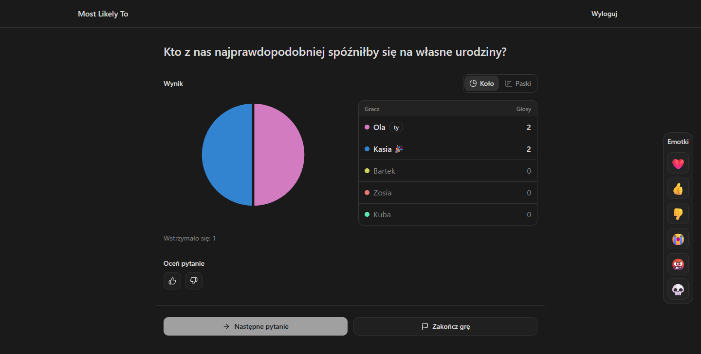
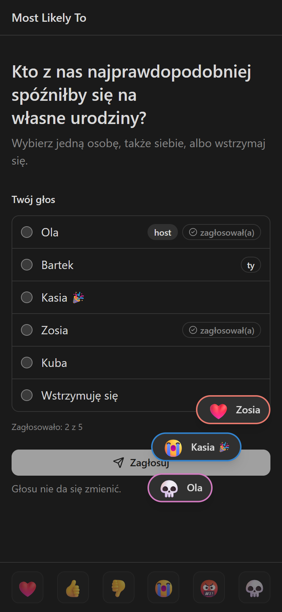
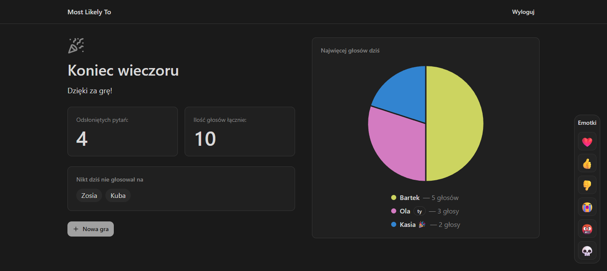

# Most Likely To

A live party game for a group of friends on a call. Everyone sees the same “Who's most likely to…?” question on their phone, casts one anonymous vote, and the result appears on every screen the moment the last vote lands.

**[▶ Play](https://most-likely-to.charlesonthewave.workers.dev)** (the game's interface is in Polish)



| Voting on a phone, with emotes                                                                     | End of the evening                                                                                            |
| -------------------------------------------------------------------------------------------------- | ------------------------------------------------------------------------------------------------------------- |
|  |  |

## How to play

1. **The host** signs in with Discord or Google, picks question categories (18+ is opt-in per category), reviews the question list and shares a link.
2. **Friends** open the link and type a nick. No account, nothing to install.
3. **Everyone votes** for one player, themselves included, or abstains. You see who has voted, never for whom.
4. **The reveal** comes after the last vote, on every screen at once: a pie or bar chart with the counts. Then you talk about it, rate the question with a thumb and send emotes.
5. **The host** (or a co-host they pick) moves on, skips a question, lets latecomers in and ends the game with a summary of the evening.

No points, no leaderboard, no timers, on purpose: the game is the conversation.

## What's inside

- **Anonymous by design.** The app never stores, logs or returns who voted for whom. A round in progress lives only in unlogged private tables that no API role can read, and they are deleted at the reveal; an hourly `pg_cron` sweep closes abandoned games.
- **Live without a game server.** After every move the Worker rings a Supabase Realtime channel, and each screen fetches the new state from the server. Screens also poll, so the game goes on when the live connection drops.
- **Guests without accounts.** A guest's cookie holds a random token and the database keeps only its SHA-256. Every write goes through `security definer` Postgres functions with all checks inside, behind row-level security.
- **Accessible.** State changes are announced to screen readers, the focus moves to the new view after the host's move, and colour is never the only carrier of information.

## Tech stack

| Layer       | Tools                                                                                                                                                                          |
| ----------- | ------------------------------------------------------------------------------------------------------------------------------------------------------------------------------ |
| Frontend    | [Astro](https://astro.build/) 7 (SSR) with [React](https://react.dev/) 19 islands, TypeScript, [Tailwind CSS](https://tailwindcss.com/) 4, [shadcn/ui](https://ui.shadcn.com/) |
| Backend     | [Cloudflare Workers](https://workers.cloudflare.com/) (Astro API routes)                                                                                                       |
| Data & auth | [Supabase](https://supabase.com/): Postgres (RLS, `security definer` functions, `pg_cron`), Auth (Discord, Google, email), Realtime                                            |
| Tests       | Vitest (unit), database tests through REST/RPC, pgTAP, Playwright end-to-end with several players in one room, an HTTP smoke test                                              |
| CI/CD       | GitHub Actions: `ci`, `smoke`, `db` and `e2e` must be green to merge; Cloudflare Workers Builds deploys `main`                                                                 |

## How it was built

Solo, after hours, in about five weeks (first commit on 25 September 2026). AI coding agents ([Claude Code](https://claude.com/claude-code)) did most of the typing; I made the product, design and risk decisions. The process is spec-first, and every artifact is in this repo:

- **Product:** a PRD (`context/foundation/prd.md`) and a roadmap of thin end-to-end slices (`context/foundation/roadmap.md`), each one playable on its own.
- **Every change:** research, a plan, an independent review of the plan, then implementation phase by phase with one commit per green phase, and a review of the code against the plan. 18 finished changes are in `context/archive/`.
- **Guardrails for the agents:** `AGENTS.md` holds the hard rules (vote anonymity, no points or timers, which commands need my consent). Agent hooks lint every edit. A PR merges only on green CI, and new tests are proven by a break-check: break the code on purpose, watch the test go red, revert.
- **Humans in the loop:** I chose the look of the screens from screenshot variants, and game nights with friends shaped the roadmap (player colours, and picking your own colour, came from their feedback).

## Run it locally

Needs Node.js 22 (`.nvmrc`) and Docker for a local Supabase.

```bash
npm ci
npx supabase start          # local Supabase; applies supabase/migrations
cp .env.example .dev.vars   # then set SUPABASE_URL and the publishable SUPABASE_KEY it printed
npm run dev
```

Scripts, routes, tests, CI and database migrations: [docs/development.md](docs/development.md).
