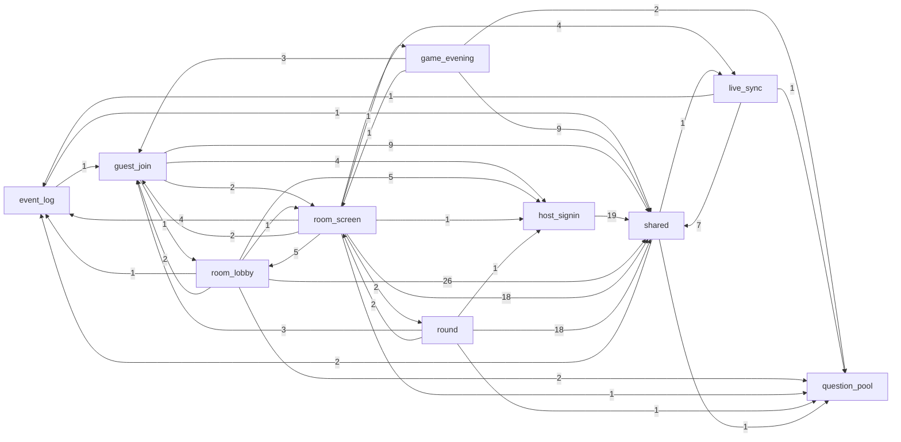
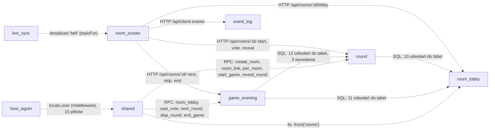

# Evidence: structure

Pytanie: jak daleko sięga zmiana w każdej zdolności i gdzie granice są złamane. Graf wyjaśnia zdolności, nie szereguje ich. HEAD `785f859`, tylko pliki śledzone (`git ls-files`). Przypisanie do zdolności wyłącznie przez `.work/file-capability.tsv` (dokładne ścieżki z HEAD przepisane do `.work/structure-modules.tsv`, 0 plików poza mapą). Dane surowe: `context/map/.work/structure-*`.

## Graph sources

| Język / warstwa | Źródło | Poziom | Pewność | Ślepe punkty |
| --- | --- | --- | --- | --- |
| TS / TSX / Astro (`src/`, 93 pliki) | API kompilatora TypeScript z projektu (`node_modules/typescript` 6.0.3, tylko odczyt): `import`, `import type`, `export … from`, `import()`, `require`; alias `@/*` → `src/*` z `tsconfig.json`; w `.astro` frontmatter + 2 bloki `<script>` (wycięte wyrażeniem regularnym, nie kompilatorem Astro) | 2 (toolchain projektu) | **wysoka** dla krawędzi importu: 0 nierozwiązanych specyfikatorów, 0 dynamicznych `import()`, 0 `vi.mock`; `verbatimModuleSyntax: true` (astro/tsconfigs/base) wymusza `import type`, więc podział runtime/type jest składniowo wiarygodny | wywołania SQL (`.rpc`), kanały Realtime, adresy HTTP w stringach, `locals` wstrzykiwane przez middleware, routing plikowy Astro, podział serwer/przeglądarka (`client:*`) |
| Repo już ma | jedna reguła granic w `eslint.config.js` (`@typescript-eslint/no-restricted-imports`: testy nie importują klienta Supabase poza `tests/db/support/clients.ts`); brak narzędzia grafu w manifestach i CI | 1 (tylko reguła, nie graf) | — | — |
| JS (`scripts/`, `.claude/hooks/`, configi; 11 plików) | ten sam parser TS | 2 | wysoka | configi importują tylko pakiety; 4 krawędzie wewnętrzne (`structure-edges-js.csv`) |
| Testy (`tests/`, 34 pliki) | ten sam parser, osobny plik `structure-edges-tests.csv` (poza grafem produktu) | 2 | wysoka | — |
| SQL (`supabase/migrations/`, 4 pliki; `supabase/tests/` pgTAP) | **brak grafu**; dopasowanie tekstu (`create function`, nazwy tabel w ciałach funkcji, `grant … to anon`, `cron.schedule`, `create policy`) → `structure-edges-sql.csv` (56 krawędzi) | 4 (fallback tekstowy) | **niska** (`inference`) | wywołania przez dynamiczny SQL, kolejność nadpisań poza ostatnią definicją, triggery (0 znalezionych tekstem), RLS jako zależność |
| YAML (`.github/workflows/ci.yml`) | brak grafu; tylko lista jobów (`ci`, `smoke`, `db`, `e2e`) | — | — | — |

Wynik dla produktu (`structure-edges-ts.csv`): 256 krawędzi plik→plik, **235 runtime, 21 type-only**, 0 build; 91 węzłów (90 plików kodu + `src/styles/global.css`). Bez krawędzi runtime: `src/components/ui/LibBadge.astro` (brak importera — `evidence`; prawdopodobnie martwy kod — `inference`), `src/env.d.ts`, `src/pages/auth/signup.ts`.

## Capability graph

`evidence` (graph-metrics, `--modules structure-modules.tsv --kind runtime`): 10 zdolności, 37 krawędzi między zdolnościami, 165 z 235 krawędzi runtime przekracza granicę zdolności (70 wewnątrz). Ca/Ce liczone w zdolnościach; kolumny „plik-krawędzie” to liczba krawędzi plik→plik przez granicę (z `structure-fold.txt`).

| Zdolność | Krytyczność | Pliki w grafie | Ca | Ce | Niestabilność | Plik-krawędzie wchodzące | Plik-krawędzie wychodzące |
| --- | --- | --: | --: | --: | --: | --: | --: |
| shared (bucket) | high | 22 | 8 | 3 | 0.27 | 107 (+11 type) | 4 |
| host-signin | high | 19 | 4 | 1 | 0.20 | 11 | 19 |
| guest-join | high | 4 | 5 | 4 | 0.44 | 11 | 16 |
| live-sync | high | 10 | 2 | 3 | 0.60 | 5 | 9 |
| room-lobby | high | 8 | 2 | 6 | 0.75 | 6 | 37 (+1 type) |
| round | high | 8 | 1 | 5 | 0.83 | 2 (+1 type) | 25 (+6 type) |
| game-evening | high | 4 | 1 | 4 | 0.80 | 1 | 15 (+2 type) |
| room-screen | medium | 11 | 4 | 9 | 0.69 | 6 (+4 type) | 38 (+7 type) |
| question-pool | medium | 2 | 6 | 0 | 0.00 | 8 | 0 |
| event-log | medium | 3 | 4 | 2 | 0.33 | 8 (+1 type) | 2 (+1 type) |
| platform (bucket) | high | 0 | — | — | — | poza grafem produktu (config jako kod, CI) | — |

Diagram (`evidence`, krawędzie runtime z importów, etykieta = liczba krawędzi plik→plik; ten sam zbiór 37 krawędzi co `--emit mermaid`, plik `.work/structure-capability-graph-labeled.mmd`):

Krawędzie niewidoczne dla grafu importów (`inference`, dopasowanie tekstu; szczegóły `.work/structure-ts-sql-realtime.txt`, `.work/structure-sql.txt`). Zdolność funkcji SQL = migracja, która definiuje ją **ostatnia**:

(Ostatnia krawędź jest uproszczeniem: `locals.user` czytają pliki z room-lobby, guest-join, round, game-evening, room-screen i live-sync — lista niżej.)

## Blast radius per capability

`evidence` z `structure-fold.txt` (zasięg przechodni po krawędziach runtime; „wejścia” = pliki `src/pages/**` i `src/middleware.ts` w innych zdolnościach). Wiersze z `inference` oznaczają krawędzie z dopasowania tekstu.

| Zdolność (high) | Kto zależy (bezpośrednio) | Zasięg przechodni w górę | Od czego zależy | Kontrakty importowane przez inne zdolności |
| --- | --- | --- | --- | --- |
| shared | 8 zdolności, 107 plik-krawędzi | 52 pliki, 26 z 27 wejść, 8 zdolności | event-log (`log.ts`), live-sync (`ringRoom`), question-pool (`draw.ts`) | `src/lib/supabase.ts` (20 plików / 7 zdolności), `src/lib/rooms/server.ts` (12 / 5; 16 funkcji), `ui/button.tsx` (13 / 5), `layouts/Layout.astro` (9 / 5), `rooms/json-route.ts` (8 / 4), `rooms/shared.ts` (7 runtime + 11 type), `rooms/errors.ts`, `lib/utils.ts` (`cn`) |
| host-signin | guest-join (4), room-lobby (5), room-screen (1), round (1) — wszystkie do `src/components/auth/{FormField,ServerError,SubmitButton,useSubmitPending}` | 13 plików, 5 wejść | tylko shared (19) | `ServerError` (5 plików / 4 zdolności), `FormField`, `SubmitButton`, `useSubmitPending` (po 2 / 2). `inference`: middleware ustawia `locals.user`, czytane w 15 plikach 6 zdolności (`index.astro`, `j/[token]`, `r/[id]`, `dev/live-sync`, 9 route'ów `api/rooms/**`, `api/live-sync/ring`, `AppHeader.astro`) — niewidoczne w grafie |
| guest-join | 10 plików z 5 zdolności → `src/lib/rooms/tokens.ts`; dev-strona → `JoinForm` | 12 plików, 11 wejść | shared (9), host-signin (4), room-screen (2), room-lobby (1) | `tokens.ts`: `UUID_PATTERN`, `playerCookieName`, `PLAYER_TOKEN_PATTERN`, `newLinkToken`. `inference`: SQL `join_room` i `room_link` (oba granted `anon`) mają ostatnią definicję w migracji round |
| live-sync | room-screen (4: `LiveBanner`, `announce.ts`, `limiter.ts`, `live-sync/shared.ts`), shared (1: `rooms/server.ts` → `live-sync/server.ts`) | 18 plików, **14 wejść** — przez `ringLobby` każdy z 8 route'ów pokoju dosięga Realtime | shared (7), event-log (1), question-pool (1) | `ringRoom`, `BELL_EVENT`, `topicFor`, `LOBBY_POLL_MS`, `createFetchLimiter`, `announcement*`. `inference`: nadawca `httpSend` → odbiorcy `useRoomState.ts`, `LiveSyncDemo.tsx`, `scripts/live-sync-probe.mjs` |
| room-lobby | room-screen (5: `RoomScreen` → `RoomLobby` + 4 z dev-galerii), guest-join (1: `RoomCard`) | 5 plików, 4 wejścia | shared (26), host-signin (5), guest-join (2), question-pool (2), event-log (1), room-screen (1) | komponenty UI (`RoomCard`, `RoomLobby`/`LobbyPreview`). `inference`: tabele `rooms`, `players`, `player_secrets` + 5 polityk RLS — czytane przez 21 odwołań z funkcji round i game-evening; funkcja `room_lobby` ma ostatnią definicję w migracji game-evening |
| round | room-screen (2: `RoundVoting`, `RoundReveal`) | 4 pliki, 3 wejścia | shared (18), guest-join (3), room-screen (2), host-signin (1), question-pool (1) | tylko komponenty. `inference`: tabele `private.rounds`, `round_results`, `ballot_boxes`, `round_voters` — 12 odwołań z funkcji game-evening; `cast_vote` (granted `anon`) jest dziś zdefiniowany w migracji game-evening (`drop` + `create`) |
| game-evening | room-screen (1: `RoundSkipped`) | 4 pliki, 3 wejścia | shared (9), guest-join (3), question-pool (2), room-screen (1) | brak w TS. `inference`: 7 funkcji SQL (`next_round`, `skip_round`, `end_game`, `cast_vote`, `room_lobby`, `open_next_round`, `close_stale_games`) + zadanie `cron.schedule('close-stale-games', '0 * * * *')`; wywołuje `private.finish_round` i `private.drop_round_state` z round |
| platform | — | — | — | poza grafem importów: `astro.config.mjs`, `tsconfig.json` (alias `@/*`), `wrangler.jsonc`, CI. 1 krawędź build (`playwright.config.ts` → `tests/e2e/support/env.ts`) — `unknown` jako zasięg |

Medium, w skrócie (`evidence`): question-pool to liść (Ce 0) z Ca 6 — `draw.ts` (game-evening, round, shared) i `data/questions.ts` (live-sync, room-lobby, room-screen), przechodnio 15 wejść. event-log: `log.ts` importowany przez 8 plików 4 zdolności, przechodnio 16 wejść. room-screen: 5 plików w górę, 2 wejścia, ale Ce 9 zdolności (powłoka kompozycji).

## Cycles

`evidence`: **0 cykli na poziomie plików** — ani runtime, ani przy wszystkich rodzajach krawędzi (graph-metrics bez `--modules`, `--kind runtime` i `--kind all`). Najmniejsza prawdziwa pętla: **brak**.

Na poziomie zdolności graph-metrics raportuje jedną silnie spójną składową z 9 zdolności (wszystkie poza question-pool). To efekt zwijania plików do zdolności, nie pętla w kodzie (`inference`). Siedem par zdolności ma krawędzie w obie strony, zawsze przez **różne** pliki:

| Para | A → B (pliki) | B → A (pliki) |
| --- | --- | --- |
| room-screen ↔ round | `RoomScreen.tsx` → `RoundVoting`, `RoundReveal` | `RoundVoting`, `RoundReveal` → `HostActions.tsx` |
| room-screen ↔ game-evening | `RoomScreen.tsx` → `RoundSkipped` | `RoundSkipped` → `HostActions.tsx` |
| room-screen ↔ room-lobby | `RoomScreen.tsx` → `RoomLobby`; `dev/room-states` → 4 komponenty | `index.astro` → `AppHeader.astro` |
| room-screen ↔ guest-join | `r/[id].astro` → `tokens.ts`; `dev/room-states` → `JoinForm` | `j/[token].astro` → `AppHeader`, `RoomMessage` |
| guest-join ↔ room-lobby | `j/[token].astro` → `RoomCard.astro` | `api/rooms/index.ts`, `api/rooms/[id]/lobby.ts` → `tokens.ts` |
| live-sync ↔ shared | `announce.ts` → `rooms/shared.ts`; `LiveBanner`, demo, 3 strony → `ui/`, `supabase.ts`, `Layout` | `rooms/server.ts` → `live-sync/server.ts` |
| event-log ↔ shared | `api/client-events.ts` → `rooms/json-route.ts` | `json-route.ts`, `rooms/server.ts` → `log.ts` |

Cykle type-only → Mechanical signals.

## Broken boundaries

Zamierzone warstwy (`inference`): L0 fundamenty (`components/ui`, `lib/utils`, `rooms/shared.ts` — typy i parsery, `rooms/errors.ts`, `rooms/tokens.ts`, `log.ts`, `live-sync/shared.ts`, `data/questions.ts`, `rounds/draw.ts`) → L1 dostęp do danych (`supabase.ts`, `rooms/server.ts`, `rooms/json-route.ts`, `live-sync/server.ts`) → L2 funkcje (`components/<obszar>`, `useRoomState`) → L3 wejścia (`pages/**`, `api/**`, `middleware.ts`).

| # | Krawędź runtime (`evidence`) | Co łamie (`inference`) | Skutek |
| --- | --- | --- | --- |
| 1 | `src/lib/rooms/server.ts` → `src/lib/live-sync/server.ts` (`ringRoom`) | wspólny rdzeń (bucket shared) zależy od modułu zdolności live-sync | każdy z 8 route'ów pokoju dosięga Realtime; `live-sync/server.ts` dalej → `data/questions.ts` (komentarz w pliku: „Prototype shortcut: F-01 has no tables”) |
| 2 | `src/lib/rooms/server.ts` → `src/lib/rounds/draw.ts` (`questionPool`, `questionText`) | rdzeń shared zależy od logiki question-pool | łagodne: `draw.ts` jest czysty i ma test jednostkowy |
| 3 | 5 plików w guest-join, room-lobby, room-screen, round → `src/components/auth/{ServerError,FormField,SubmitButton,useSubmitPending}` | funkcja → wnętrze UI innej funkcji (host-signin); faktycznie wspólny zestaw formularzy trzymany w folderze logowania | zmiana UI logowania sięga formularza dołączania, nowej gry, paska hosta i głosowania |
| 4 | 10 plików w 5 zdolnościach (event-log, game-evening, room-lobby, room-screen, round) → `src/lib/rooms/tokens.ts` (guest-join) | stałe fundamentu (cookie gracza, wzorzec UUID) przypisane do zdolności; to cięcie `capabilities.tsv`, nie wada kodu | `tokens.ts`: Ca 12, Ce 0 — jeden z najbardziej obciążonych kontraktów |
| 5 | `RoundVoting`, `RoundReveal` (round), `RoundSkipped` (game-evening) → `room-screen/HostActions.tsx`, a `RoomScreen.tsx` importuje je z powrotem | dziecko kompozycji importuje rodzeństwo powłoki; brak pętli plików | pętle zdolności room-screen ↔ round / game-evening |
| 6 | `src/lib/live-sync/server.ts` → `src/data/questions.ts` | live-sync (transport) zna treść pytań | pozostałość prototypu F-01 (`stateFor`, `/api/live-sync/state`) |
| 7 | SQL (`inference`): funkcje game-evening czytają/zmieniają tabele round (12) i room-lobby (11); funkcje round — tabele room-lobby (10) | granice SQL idą za kolejnością zmian, nie za zdolnościami: `first_live_round.sql` odtwarza `normalize_nick`, `create_room`, `join_room`, `room_link`, `room_lobby`; `full_game_evening.sql` usuwa i odtwarza `cast_vote`, zastępuje `room_lobby` | zmiana dołączania lub poczekalni = nowa migracja nadpisująca funkcję, której aktualne ciało leży w migracji innej zdolności |

Zgodne z warstwami (nie łamią): wejścia składają komponenty innych zdolności (`j/[token].astro` → `RoomCard`, `AppHeader`); room-screen konsumuje live-sync (`useRoomState` → `limiter`, `live-sync/shared`).

## Test risks

`evidence` z `structure-edges-tests.csv` / `structure-test-edges.txt`: testy importują 14 z 93 plików produktu, wszystkie z `src/lib/**` lub `src/data/**`; **0 importów z `src/pages/**` i `src/components/**`**; 0 `vi.mock`.

| Zdolność | Co wciąga | Gdzie da się testować | Ryzyko |
| --- | --- | --- | --- |
| shared | `rooms/server.ts` (381 linii, 16 funkcji, wszystkie 10 RPC + 3 odczyty tabeli) bierze `SupabaseClient` jako parametr (DI) | unit z atrapą klienta byłby możliwy; dziś **0 importów w testach** | kontrakt TS↔SQL (argumenty, kształt JSON, `unexpectedShape`) sprawdza tylko e2e (job CI). Testy db wołają RPC same (`tests/db/support/rounds.ts`: `call(client, "start_game", …)`), powielając nazwy i argumenty jako stringi |
| host-signin | route'y wołają `supabase.auth.*` (hasło, OAuth, `exchangeCodeForSession`); `supabase.ts` → `astro:env/server`, `@supabase/ssr` (cookies) | unit tylko `auth-user.ts` (1 z 20 plików) | middleware i callback OAuth tylko e2e (`tests/e2e/auth.setup.ts`) |
| room-lobby, guest-join, round, game-evening | route'y 25–57 linii: `locals.user`, `createClient`, `locals.cfContext`; logika w SQL | db (`tests/db/*`, przez REST/RPC) + pgTAP (10 trafień wzorca `close_stale_games` / `cron.` w `supabase/tests/round_creator_view.test.sql`) + e2e | wszystkie trzy warstwy uruchamiają się tylko w CI (lokalnie brak Dockera — AGENTS.md); game-evening ma 0 plików TS z testem jednostkowym |
| room-screen | `useRoomState.ts` (347 linii): przeglądarkowy klient Supabase + kanał Realtime + `fetch` + `client-events` | unit tylko parsery (`room-state.test.ts` → `rooms/shared.ts`) | powłoka (`RoomScreen.tsx`, Ce 13 plików) i hook — tylko e2e |
| live-sync | `ringRoom` (`httpSend`), subskrypcje | unit: `limiter`, `announce` | dostarczenie dzwonka: e2e `lobby-connection-drop.spec.ts` + atrapa `tests/e2e/support/realtime.ts`; probe (`scripts/live-sync-probe.mjs`) ma własną kopię `BELL_EVENT` |
| event-log, question-pool | czyste moduły | unit (`log`, `client-events`, `draw`) | niskie |

## Centres and thin entry points

`evidence` (graph-metrics na poziomie plików, `--kind runtime`):

| Plik | Zdolność | Ca | Ce | I | Odczyt |
| --- | --- | --: | --: | --: | --- |
| `src/lib/supabase.ts` | shared | 20 | 0 | 0 | fabryka klienta (32 linie); fan-in z założenia (reguła 2), ale niesie zachowanie env/cookies do 7 zdolności |
| `src/components/ui/button.tsx` | shared | 14 | 1 | 0.07 | design system shadcn — fan-in z założenia, mechaniczny |
| `src/lib/rooms/server.ts` | shared | 12 | 4 | 0.25 | **rdzeń nośny**: jedyna brama TS→SQL i dzwonek; 381 linii |
| `src/lib/rooms/tokens.ts` | guest-join | 12 | 0 | 0 | kontrakt stałych (45 linii), patrz Broken boundaries #4 |
| `src/lib/log.ts` | event-log | 9 | 0 | 0 | kontrakt logowania z listą dozwolonych pól |
| `src/layouts/Layout.astro` | shared | 9 | 3 | 0.25 | layout, fan-in z założenia |
| `src/lib/rooms/json-route.ts` | shared | 8 | 1 | 0.11 | wspólne odpowiedzi route'ów |
| `src/lib/rooms/shared.ts` | shared | 8 (+11 type) | 0 | 0 | typ `RoomView` i parsery JSON z SQL — 19 importerów łącznie |
| `src/components/room/room-frame.ts`, `src/lib/live-sync/shared.ts` | room-screen, live-sync | 7 | 0 | 0 | szerokości ekranu; temat kanału i `BELL_EVENT` |
| `src/components/room/RoomScreen.tsx` | room-screen | 3 | 13 | 0.81 | powłoka kompozycji (komponent, nie strona) — składa 8 zdolności |

Cienkie wejścia (`evidence`: 27 kandydatów na wejście, wszystkie to `src/pages/**` lub `middleware.ts` — wejścia z konwencji Astro): 17 route'ów `api/**` ma 11–57 linii i Ce 1–5; 9 route'ów pokoju deleguje do `rooms/server.ts` + `json-route.ts` + `supabase.ts` (+ `tokens.ts`), 4 route'y logowania — do `supabase.auth.*` — rdzeń jest w `server.ts` i w SQL, nie w route'ach. Strony `r/[id].astro` (72 linie, Ce 10) i `j/[token].astro` (82, Ce 9) składają widok. Największy plik wejściowy, `src/pages/dev/room-states.astro` (1087 linii, Ce 12), to galeria tylko dla dev (`import.meta.env.DEV`).

## Mechanical signals

| Sygnał | Liczba | Uwagi |
| --- | --: | --- |
| Krawędzie type-only (produkt) | 21 | 11 do `rooms/shared.ts`, 5 do `room-actions.ts`, 2 do `HostActions.tsx`; `json-route.ts` → `server.ts` tylko type. Testy: 4 |
| Cykl type-only między zdolnościami | 1 | room-screen ↔ round (`RoomScreen` → `chart.ts`; `RoundVoting`/`RoundReveal` → `room-actions.ts`) — reguła 9 |
| Krawędzie build / narzędzi | 1 | `playwright.config.ts` → `tests/e2e/support/env.ts`; hooki: 3 krawędzie do `.claude/hooks/lib.mjs` (wewnątrz platform) |
| Fan-in z założenia (config jako kod / design system) | importery spoza shared: `ui/button` 13, `Layout.astro` 9, `utils.ts` (`cn`) 6, `supabase.ts` 20 | reguła 2; zmianę sygnatur łapie `npx astro check` w CI (strict TS) |
| Strony dev (`src/pages/dev/*`, 4 pliki) | 24 krawędzie runtime | bez nich graf zdolności traci tylko 1 krawędź (room-screen → question-pool); 36 zamiast 37 |
| Import CSS jako efekt uboczny | 1 | `Layout.astro` → `styles/global.css` |
| Nadpisania funkcji SQL między migracjami | 6 funkcji (`normalize_nick`, `create_room`, `join_room`, `room_link`, `room_lobby` ×2, `cast_vote` drop+create) | lockstep zasady „nowa migracja zamiast edycji” (AGENTS.md); strażnikiem są job `db` i pgTAP (reguła 3) |

## Unknowns

- **SQL nie ma grafu** (`unknown`): funkcje SQL (16, z czego 11 `security definer`), polityki RLS (5 na `rooms`/`players`), zadanie pg_cron, ewentualne triggery (0 znalezionych tekstem). Lista z dopasowania tekstu jest `inference`, nie „brak zależności”.
- **TS → SQL** (`unknown` dla kompilatora): 10 nazw RPC jako stringi w `callRpc` (`src/lib/rooms/server.ts`) + 3× `.from("rooms")`; kształt odpowiedzi sprawdzany w czasie działania (`parseLobbyState`, `unexpectedShape`). Kopie nazw w `tests/db/support/{rounds,rooms}.ts`.
- **Supabase Realtime**: tylko broadcast (`channel(topicFor(room))`, zdarzenie `bell`); w migracjach tekstowo brak `postgres_changes` i `alter publication`. Przepływ nadawca → odbiorcy idzie przez sieć, nie przez import; `scripts/live-sync-probe.mjs` trzyma własną kopię `BELL_EVENT`.
- **HTTP z wysp do route'ów**: `room-actions.ts` składa `/api/rooms/${roomId}/${action}` dla 6 akcji; `useRoomState.ts` → `/lobby` i `/api/client-events`; formularze → własne route'y. Niewidoczne w grafie.
- **Wstrzykiwane przez framework**: routing plikowy Astro (27 wejść), middleware na każdym żądaniu (`locals.user` w 15 plikach), `locals.cfContext` z adaptera Cloudflare, moduł wirtualny `astro:env/server`, bindingi z `wrangler.jsonc`. Podział serwer / przeglądarka (`client:*`) nie jest rozróżniony.
- **Konsumenci zewnętrzni** (`unknown (external)`): RPC przyznane `anon` (`join_room`, `room_link`, `room_lobby`, `cast_vote`) i route'y `/api/*` są wywoływalne spoza repo kluczem publishable z przeglądarki.
- **YAML (CI)**: bez grafu; joby `ci`, `smoke`, `db`, `e2e` wymienione tylko z nazwy.
- **Parser `.astro`**: frontmatter i `<script>` wycięte wyrażeniem regularnym (18/18 plików ma frontmatter, 2 bloki `<script>`), nie kompilatorem Astro.
- **Narzędzia warte instalacji** (nic nie instalowano): `dependency-cruiser` lub `skott` (reguły granic w CI, np. „shared nie importuje zdolności”, „funkcje nie importują `components/auth`”); dla SQL — `plpgsql_check` albo zapytania do katalogu w jobie `db`, żeby dostać prawdziwe zależności funkcji od tabel.

Polecenia (wszystkie tylko do odczytu, poza zapisem do `context/map/.work/` i tego pliku):

- `git -c core.quotepath=off ls-files` (lista plików, `supabase/`, `src/pages`, `.github`)
- `node -e "require.resolve('typescript')"`, `ls node_modules/...`, `which rg ast-grep madge depcruise skott` (żadne narzędzie grafu nie jest zainstalowane)
- `node <scratchpad>/extract-edges.cjs` (API kompilatora TypeScript z projektu) → `structure-edges-{ts,js,tests,detail}.csv`, `structure-externals.csv`, `structure-unresolved.csv`
- `node .claude/skills/10x-repo-map/scripts/graph-metrics.mjs` z `--modules structure-modules.tsv --kind runtime|type|all`, `--exclude '^src/pages/dev/'`, `--emit mermaid`, `--format json`
- `node <scratchpad>/fold.cjs` → `structure-fold.txt`, `structure-cross-edges.txt`; `node <scratchpad>/sql-edges.cjs` → `structure-sql.txt`, `structure-edges-sql.csv`
- Grep: `.rpc(`, `callRpc` / nazwy funkcji SQL, `.from(`, `.channel(`, `broadcast`, `httpSend`, `"/api/…"`, `locals.user`, `grant execute`, `close_stale_games` w testach; `wc -l` dla stron i modułów centralnych; `sed -n` do potwierdzenia `server.ts`, `live-sync/server.ts`, `eslint.config.js`, crona
