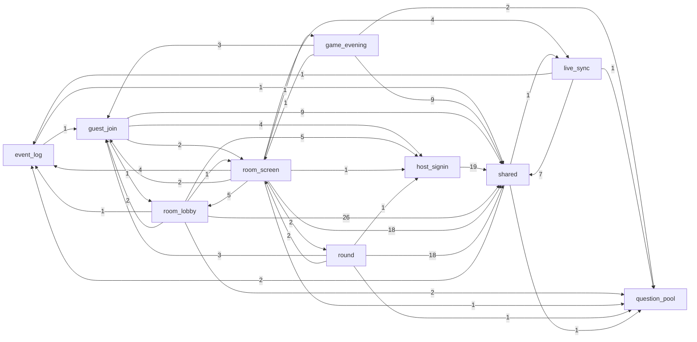

# Mapa projektu: Most Likely To

## TL;DR

"Most Likely To" to imprezowa gra w przeglądarce. Host loguje się i zakłada pokój. Goście wchodzą z linku i podają nick. Wszyscy widzą to samo pytanie, każdy oddaje jeden anonimowy głos, a wynik pokazuje się po ostatnim głosie. Wieczór to seria takich rund. Kod ma 9 możliwości biznesowych. Logika gry siedzi głównie w funkcjach SQL (`supabase/migrations/`). W TypeScripcie jedyną bramą do tych funkcji jest `src/lib/rooms/server.ts`, a synchronizacja na żywo (Supabase Realtime) przechodzi przez dzwonek `ringRoom`. Szum jest równy w całym repo, bo w 3,5 tygodnia zbudowano wszystko od zera. Prawie cała pozorna presja (13 rewertów, 15 czerwonych przebiegów CI, poprawki) to celowe break-checki i stała runda poprawek po impl-review. Nie ma śladu awarii na produkcji. Naprawdę boli w dwóch miejscach. Pierwsze to **logowanie hosta**: po wydaniu wyszedł tam realny defekt, a część poprawek poszła prosto na `main`. Drugie to **pokój z wejściem gościa**: wydano go ze znanymi dziurami F1/F4, domkniętymi dopiero w następnej zmianie. Na obserwacji są **runda** (najostrzejsza reguła repo, czyli anonimowość, ale strażnicy działają tylko w CI) i **synchronizacja na żywo** (największy zasięg, a połowa jej powiązań jest niewidoczna dla grafu).

Graf możliwości z importów runtime (z `evidence/3-structure.md`, etykieta to liczba krawędzi plik→plik; SQL, Realtime i HTTP nie są tu widoczne, opisuje je sekcja „Realne powiązania”):

## Teren

Skala szumu dla każdej rodziny jest względna wobec pozostałych możliwości: W = wysoki, Ś = średni, N = niski. Liczby zmian i commitów są po korekcie, czyli bez szkieletu startera `237a2970` i bez 13 par TEMP→Revert (`evidence/1-history.md` § Activity).

| Możliwość | Co robi | Krytyczność (kryteria) | Zmiana | Poprawki | Tarcie | Uwaga | Zasięg | Trend | Gdzie żyje |
| --- | --- | --- | --- | --- | --- | --- | --- | --- | --- |
| **host-signin**: Logowanie hosta | logowanie e-mailem i przez OAuth, sesja, wylogowanie | high: tożsamość i dostęp, publiczne wejście, zewnętrzny OAuth | Ś (51 zmian / 11 commitów) | Ś (3 fixy, 1 realny defekt po wydaniu) | **W** | **W** (2 zmiany, 47 zmian prozy, 26 ustaleń F) | Ś (formularze auth w 4 możliwościach; `locals.user` w 15 plikach, `inference`) | wygasa: brak zmian od 11.10 | `src/pages/api/auth/`, `src/components/auth/`, `src/middleware.ts` |
| **room-lobby**: Nowa gra, pokój i poczekalnia | host zakłada pokój i link, widzi listę graczy | high: dane użytkowników, RLS, inne możliwości zależą od pokoi | **W** (39 / 21; `RoomLobby.tsx` 10) | N (1 własny fix) | **W** (znana dziura F1 po wydaniu) | **W** | Ś (SQL: 21 odwołań do jego tabel, `inference`) | rośnie | `src/pages/api/rooms/{index,[id]/lobby}.ts`, `src/components/room/RoomLobby.tsx`, `supabase/migrations/*room_lobby*` |
| **guest-join**: Dołączanie gościa | link `/j/<token>`, nick, sekret gracza | high: publiczne wejście `anon`, tworzy dane gracza | Ś (20 / 11) | N | **W** (F4, nicki; ta sama przyczyna co F1) | **W** (zmiany wspólne z room-lobby + audyt) | Ś (`tokens.ts` Ca 12, wynik cięcia mapy) | rośnie | `src/pages/j/`, `src/pages/api/rooms/join.ts`, `src/lib/rooms/tokens.ts` |
| **round**: Runda, anonimowy głos i odsłona | pytanie, jeden anonimowy głos, wynik po ostatnim głosie | high: główna wartość, twarda reguła anonimowości, `cast_vote` dla `anon` | **W** (42 / 13; największy PR) | Ś (1 realny defekt przed merge) | N | Ś (29) | N (TS: 4 pliki; SQL: 12 odwołań z wieczoru, `inference`) | nowa (W42) | `src/pages/api/rooms/[id]/{start,vote,reveal}.ts`, `src/components/room/Round*.tsx`, `supabase/migrations/*first_live_round*` |
| **game-evening**: Przebieg wieczoru | następne pytanie, pominięcie, koniec gry, cogodzinne zamykanie porzuconych gier | high: usuwa stan rundy, zadanie pg_cron | Ś (15 / 8) | N | N | Ś (24) | N (TS); ma aktualne definicje `cast_vote` i `room_lobby` (`inference`) | nowa (W42) | `src/pages/api/rooms/[id]/{next,skip,end}.ts`, `supabase/migrations/*{full_game_evening,close_stale_games}*` |
| **live-sync**: Synchronizacja na żywo | Realtime broadcast `bell`, odświeżanie stanu, baner połączenia | high: zależą od niej poczekalnia i runda, zewnętrzny Realtime | Ś (28 / 16) | N | N | Ś (33 + audyt) | **W** (14 wejść przez `ringRoom`) | stała | `src/lib/live-sync/`, `src/lib/rooms/announce.ts`, `src/components/room/LiveBanner.tsx` |
| **room-screen**: Ekran pokoju | okno gry na telefonie i dużym ekranie, pasek hosta | medium: to, co widzą gracze | **W** (41 / 12) | N | N | Ś (20) | N (konsument, Ce 9) | rośnie | `src/pages/r/[id].astro`, `src/components/room/{RoomScreen,useRoomState,HostActions,room-frame}*` |
| **question-pool**: Pula pytań | wbudowana baza pytań i losowanie | medium: treść gry, dane statyczne | N (9 / 6) | N | N | Ś (20) | Ś (Ca 6, 15 wejść) | sezonowa | `src/data/questions.ts`, `src/lib/rounds/draw.ts` |
| **event-log**: Dziennik zdarzeń | `logEvent` i zdarzenia z przeglądarki z listą dozwolonych pól | medium: publiczny endpoint, ochrona prywatności | N (10 / 3) | N | N | N (brak własnego planu) | Ś (`log.ts` Ca 9) | sezonowa | `src/lib/log.ts`, `src/lib/client-events.ts`, `src/pages/api/client-events.ts` |

Bez rankingu:

- **shared** (wspólne fundamenty, high, bo zależy od niego 8 możliwości): design system (`src/components/ui/`, `src/styles/global.css`), `src/lib/supabase.ts` (Ca 20) i **wspólny serwer pokoju** `src/lib/rooms/{server,shared,errors,json-route}.ts`. Sam `server.ts` ma Ca 12, 381 linii i nie importuje go żaden test.
- **platform** (high, bo push na `main` od razu wdraża na produkcję, nawet przy czerwonym CI, a `main` nie jest chroniony): `.github/workflows/ci.yml`, `scripts/smoke.mjs`, `wrangler.jsonc`, hooki agenta. To największy kubełek zmian (70 / 31), ale ten szum jest mechaniczny, zob. „Wygląda na gorące, nie jest”.
- **docs** (low): proza zmian to 43,8% wszystkich zmian plików. Przypisano ją do możliwości w rodzinie „uwaga”.

**Pokrycie:** 795 policzonych zmian plików (447 w kodzie, 348 w prozie), 154 z 155 commitów. Nieprzypisane: 0%. Kubełki shared i platform mają razem 34,3% zmian kodu (32,4% po korekcie).

**Struktura folderów nie pokrywa się z możliwościami:**

- `src/lib/rooms/` obsługuje cztery możliwości: rdzeń serwera (shared), tokeny (guest-join), wyniki i wykres (round) oraz `announce.ts` (live-sync).
- `src/components/room/` mieści sześć możliwości.
- `src/components/auth/` to faktycznie wspólny zestaw formularzy: `ServerError`, `FormField`, `SubmitButton` i `useSubmitPending` importuje 5 plików z 4 innych możliwości.
- `supabase/migrations/` ma jeden plik na zmianę, więc aktualne ciało funkcji leży często w migracji innej możliwości.

## Realne powiązania

| Powiązanie | Skąd wiadomo | Mechaniczne? |
| --- | --- | --- |
| 8 możliwości → shared (107 krawędzi plik→plik), zwłaszcza `src/lib/rooms/server.ts` (10 RPC jako stringi w `callRpc`, 3× `.from("rooms")`) | graf runtime (`evidence`) + dopasowanie tekstu dla RPC (`inference`) | nie: ręcznie utrzymywany kontrakt TS↔SQL bez wygenerowanych typów DB; kopie nazw RPC w `tests/db/support/{rounds,rooms}.ts` |
| shared → live-sync: `server.ts` → `src/lib/live-sync/server.ts` (`ringRoom`), więc 14 wejść dosięga Realtime | graf runtime (`evidence`); złamana granica (rdzeń zależy od możliwości) | nie |
| live-sync → room-screen: broadcast `bell` przez `topicFor`. Nadawca to `announce.ts` / `live-sync/server.ts`, odbiorcy to `useRoomState.ts`, `LiveSyncDemo.tsx` i `scripts/live-sync-probe.mjs` (sonda trzyma **własną kopię** `BELL_EVENT`) | dopasowanie tekstu (`inference`); graf importów tego nie widzi | nie: kontrakt przez sieć |
| room-screen → round / game-evening / room-lobby / event-log: `room-actions.ts` składa `/api/rooms/${roomId}/${action}` dla 6 akcji, a `useRoomState.ts` woła `/lobby` i `/api/client-events` | dopasowanie tekstu (`inference`) | nie: adresy w stringach |
| host-signin → 6 możliwości: middleware ustawia `locals.user`, które czyta 15 plików | dopasowanie tekstu (`inference`) | wstrzykiwane przez framework |
| guest-join, room-lobby, room-screen, round → `src/components/auth/*` (5 plików) | graf runtime (`evidence`) | nie: zmiana UI logowania sięga formularza dołączania, nowej gry, paska hosta i głosowania |
| 10 plików z 5 możliwości → `src/lib/rooms/tokens.ts` (Ca 12) | graf runtime (`evidence`) | częściowo: to stałe fundamentu przypisane mapą do guest-join |
| round / game-evening → `HostActions.tsx` (room-screen), a `RoomScreen.tsx` importuje je z powrotem | graf runtime (`evidence`); 0 cykli plików | cykl na poziomie możliwości to efekt zwijania; cykl room-screen ↔ round jest tylko type-only |
| SQL: funkcje wieczoru → tabele rundy (12) i poczekalni (11), funkcje rundy → tabele poczekalni (10). `first_live_round.sql` odtwarza `create_room`, `join_room` i `room_link`, a `full_game_evening.sql` odtwarza `cast_vote` i `room_lobby` (obie dla `anon`) | dopasowanie tekstu (`inference`); grafu SQL brak | lockstep reguły „nowa migracja zamiast edycji”, który pilnują job `db` i pgTAP (mechaniczny); pułapka nawigacyjna: aktualne ciało funkcji poczekalni leży w migracji wieczoru |
| co-change: guest-join ~ room-lobby (6, 0,46), room-lobby ~ round (6, 0,43), live-sync ~ room-lobby (5, 0,45), room-lobby ~ room-screen (5, 0,50) | historia (`evidence`) | domenowe |
| co-change: każda para z platform (`ci.yml`, `smoke.mjs`, `package.json`, `.claude/settings.json`) | historia (`evidence`) | **mechaniczne**: korytarz wdrażania testów |
| RPC dla `anon` (`join_room`, `room_link`, `room_lobby`, `cast_vote`) i `/api/*` | uprawnienia w migracjach | konsumenci `unknown (external)`: każdy z kluczem publishable może je wołać |

**Sprzeczności, czyli pytania:**

1. live-sync ma największy zasięg runtime, ale co-change z room-screen to tylko 2 commity. Czy kontrakt dzwonka pilnuje wspólny moduł (`src/lib/live-sync/shared.ts`, Ca 7), skoro sonda ma własną kopię `BELL_EVENT`?
2. `src/lib/rooms/server.ts` to najbardziej nośny plik TS (jedyna brama do SQL), a nie ma testu jednostkowego i zmienia się tylko w szerokich commitach faz, których filtr co-change nie widzi. Co go pilnuje poza e2e w CI?
3. event-log pilnuje prywatności na publicznym endpoincie i importuje go 8 plików, a nikt go nie planował osobno: 0 własnych planów, 3 przekrojowe commity. Kto decyduje o liście dozwolonych pól?
4. round podlega najostrzejszej regule repo, a ma niskie tarcie. Czy to zasługa udowodnionych alarmów (break-checki), czy tego, że jego strażnicy (`tests/db`, pgTAP, e2e) chodzą tylko w CI?

## Strefy ryzyka

### 1. Logowanie hosta (host-signin)

**Dlaczego:** od tego zależy tożsamość hosta i dostęp do pokoi. Po wydaniu wyszedł tu realny defekt, a część poprawek ominęła PR. Zestaw formularzy z tego folderu i `locals.user` z middleware sięgają w głąb innych możliwości.

- **Tarcie, W** (`evidence/2-discussion.md` § Friction, pkt 2; `evidence/1-history.md` § Fix pressure):
  - `d4bff27a` to defekt po wydaniu, znaleziony audytem: middleware gubił błędy Supabase Auth.
  - `957bb6d3` to runda poprawek wysłana prosto na `main` 8,5 h po PR #2, który był otwarty 5 minut.
  - Łącznie 3 rundy poprawek w 7 dni.
- **Uwaga, W** (`evidence/2-discussion.md` § Planning attention): 2 zmiany planistyczne, 47 zmian prozy, 26 ustaleń F, 54 zrzuty.
- **Test niezależności:** dwie z trzech rund poprawek i wymiana rejestracji e-mailem na OAuth wynikają z tych samych dwóch zaplanowanych zmian. To jedna przyczyna, policzona raz. Niezależne od planowania zostają defekt z audytu i obejście PR.
- **Zasięg, Ś, wspiera** (`evidence/3-structure.md` § Broken boundaries #3): `ServerError`, `FormField`, `SubmitButton` i `useSubmitPending` importują 4 możliwości. `locals.user` czyta 15 plików (`inference`).
- **Krytyczność:** tożsamość i dostęp, publiczne wejście, OAuth. Reguła z AGENTS.md: „Confirm email” musi zostać ON.
- **Pliki:** `src/middleware.ts`, `src/lib/auth-user.ts`, `src/lib/auth-errors.ts`, `src/pages/api/auth/callback.ts`, `src/pages/api/auth/oauth.ts`, `src/components/auth/ServerError.tsx`, `src/components/auth/FormField.tsx`.
- Trend wygasa (0 zmian od 11.10). Ryzyko dotyczy następnego, kto tu wejdzie, a nie bieżącego ruchu.

### 2. Pokój, poczekalnia i wejście gościa (room-lobby + guest-join)

**Dlaczego:** to jedyne publiczne wejście bez logowania i miejsce, gdzie powstają dane graczy. Wydano je ze znanymi dziurami, które domknęła dopiero następna zmiana. Do tego aktualne ciała funkcji SQL leżą w migracjach innych możliwości.

- **Zmiana, W** (`evidence/1-history.md` § Activity, Hub files): room-lobby ma najwięcej commitów (21) i jedyny niemechaniczny hub kodu, `src/components/room/RoomLobby.tsx` (10 zmian, 6 partnerów). Trend rośnie. Zastrzeżenie: 16 z 24 commitów room-lobby jest przekrojowych, bo późniejsze zmiany redefiniują jego funkcje (`evidence/4-people.md`). Niemechaniczną kotwicą tej rodziny jest więc `RoomLobby.tsx`, a nie sama liczba commitów.
- **Tarcie, W** (`evidence/2-discussion.md` § Friction, pkt 1):
  - S-01 trafiło na `main` 08.10.
  - 10.10 testy ujawniły znane dziury: F1 (host zapisuje poza regułami) i F4 (nicki).
  - Domknięto je 14.10 w `4fedd342`, a na `main` trafiły 15.10. Z tego wychodzi około 5–7 dni na produkcji ze znanymi dziurami (`inference`).
  - F1 i F4 to jedno drugie podejście tej samej zmiany, więc liczę je raz dla obu możliwości.
- **Uwaga, W:** ma wspólną przyczynę ze zmianą („jest budowane”), więc liczę ją raz.
- **Zasięg SQL, Ś** (`inference`, `evidence/3-structure.md` § Broken boundaries #7):
  - Funkcje rundy i wieczoru robią 21 odwołań do tabel `rooms`, `players` i `player_secrets`.
  - `join_room` i `room_link` (dla `anon`) mają ostatnią definicję w `20261014101922_first_live_round.sql`, a `room_lobby` w `20261015122252_full_game_evening.sql`.
- **Krytyczność:** publiczne wejście `anon`, dane graczy, RLS, inne możliwości zależą od pokoi.
- **Pliki:** `src/pages/j/[token].astro`, `src/pages/api/rooms/join.ts`, `src/pages/api/rooms/index.ts`, `src/pages/api/rooms/[id]/lobby.ts`, `src/components/room/RoomLobby.tsx`, `src/lib/rooms/tokens.ts`, `supabase/migrations/20261007122858_room_lobby.sql` (oraz dwie późniejsze migracje wymienione wyżej).

### Do obserwacji (nie spełniają progu)

- **round, Runda.** Zmiana W i uwaga Ś mają wspólną przyczynę („jest budowane”). Poprawki Ś: jeden realny defekt (`236afc33`: głosy po awarii bazy liczone jako zera), złapany przed merge'em. To za mało na strefę. Pozostaje jednak możliwością z najostrzejszą regułą repo (anonimowość, `private.ballot_boxes` i `round_voters`). Jej strażnicy (`tests/db/round-anonymity.test.ts`, `supabase/tests/round_creator_view.test.sql`, e2e) działają tylko w CI.
- **live-sync z rdzeniem serwera pokoju.** Zasięg W: `src/lib/rooms/server.ts` → `src/lib/live-sync/server.ts`, czyli 14 wejść. Pozostałe rodziny są średnie. Połowy powiązań (broadcast, sonda z własną kopią `BELL_EVENT`) graf nie widzi. Do tego `live-sync/server.ts` wciąż importuje `src/data/questions.ts`, co zostało po prototypie F-01.

### Wygląda na gorące, nie jest

- **13 par TEMP→Revert i 15 czerwonych przebiegów CI:** to celowe break-checki i próbne alarmy, plus 3 commity „testy przed kodem”. `main` przeszedł 34 z 34 przebiegów, cofniętej pracy jest 0. Pary zawyżają commity game-evening (43%), guest-join (35%), round (32%) i room-screen (25%), a w tym 4 z 6 zmian `HostActions.tsx`.
- **Udział poprawek:** 8 z 11 fixów w kodzie to stały krok „Poprawki z impl-review”, jeden na zmianę. 4 fixy są przekrojowe i rozlewają się na room-lobby, shared i platform (reguła 12).
- **platform:** `ci.yml` (14 zmian) i `smoke.mjs` (11) to korytarz wdrażania testów w W41. Każda para co-change z platform ma tę samą przyczynę. Wysoka krytyczność platform wynika z tego, że `main` = produkcja, a nie z szumu.
- **room-screen:** zmiana W to kampania szerokiego układu w W42 i poprawki z przeglądu. To konsument (Ce 9) z małym zasięgiem.
- **Fan-in z założenia:** `src/lib/supabase.ts` (20), `ui/button` (13), `Layout.astro` (9).
- **Cykl 9 możliwości** to efekt zwijania. Cykli plików jest 0, a jedyny cykl między możliwościami jest type-only.
- **Szkielet startera `237a2970`** zawyża host-signin o 14 zmian, a także shared i platform.
- **Proza:** `test-plan.md`, `AGENTS.md` i `roadmap.md` to huby procesu (reguła 8).
- **Koncentracja 100% na jednej osobie** to baseline zespołu jednoosobowego, a nie ryzyko.

## Kogo zapytać

Baseline to jedna osoba: `CharlesOnTheWave` (jedyny autor, dwie nazwy w git) ma 100% commitów w każdej możliwości. Nikogo innego w repo ani na forge nie ma, a 9 PR-ów ma 0 recenzji. Pytanie „kogo” zamienia się więc w „który dokument przeczytać”. Uzasadnienia decyzji leżą w folderach zmian, a 90% commitów powstało ze współautorstwem agenta. Proponowana kolejność czytania (`inference`): `plan-brief.md` → `research.md` → `plan.md` → `reviews/impl-review.md` → `follow-ups/`.

| Strefa | Osoba (temat) | Dokumenty |
| --- | --- | --- |
| 1. Logowanie hosta | `CharlesOnTheWave`: ekran logowania na tokenach, OAuth, logowanie awarii Auth (baseline: 1 z 1) | `context/archive/2026-10-04-one-click-host-login/` (`plan-brief.md`, `research.md`, `plan.md`, `reviews/plan-review.md`, `reviews/impl-review.md`, `phone-test.md`); `context/archive/2026-10-04-ui-signin-contract/` (`research.md`, `plan.md`, `theme.md`, `ui-checks.md`, `reviews/*`); `context/audits/observability/2026-10-11_guest-join-live-lobby.md` (tło PR #6); `context/deployment/deploy-plan.md` § „Logowanie przez dostawców (S-05…)”; `context/foundation/prd.md` § „Dostęp i role”, „Access Control”; PR #2 i #6 |
| 2. Pokój, poczekalnia i wejście gościa | `CharlesOnTheWave`: schemat pokoju, RLS, nicki, ciasteczko gracza (baseline: 1 z 1) | `context/archive/2026-10-07-room-lobby/` (`plan-brief.md`, `research.md`, `plan.md`, `reviews/*`, `follow-ups/review-fixes.md`, `phone-test.md`); `context/archive/2026-10-10-testing-lobby-foundation/` (`research.md`, `plan.md`, `reviews/impl-review.md`, czyli znane dziury F1/F4); `context/archive/2026-10-13-first-live-round/plan.md` (domknięcie F1/F4, redefinicje `join_room`); `context/foundation/test-plan.md` § „2. Risk Map”, „6.2”; PR #1, #3, #5, #7 |
| obserwacja: round | `CharlesOnTheWave` | `context/archive/2026-10-13-first-live-round/` (`research.md`, czyli D1, i `reviews/plan-review.md`, czyli F1, na które powołuje się AGENTS.md; `reviews/impl-review.md`; `follow-ups/review-fixes.md`); `context/foundation/test-plan.md` § „6.3 Adding an anonymity check”; `context/foundation/prd.md` § „US-01”, „Non-Goals” |
| obserwacja: live-sync | `CharlesOnTheWave` | `context/archive/2026-09-27-live-sync-spike/` (`research.md`, `external-research.md`, `measurements.md`, `plan.md`, `reviews/*`); `context/foundation/test-plan.md` § „6.4”; `context/foundation/test-stack.md`; `README.md` § „Live-sync test page and probe” |

## Pierwszy dzień

1. `src/pages/r/[id].astro` → `src/components/room/RoomScreen.tsx`: strona pokoju, w którą wpięto każdy stan. Powłoka składa 8 możliwości, więc to najlepsze miejsce na pierwszy rzut oka na całość.
2. `src/lib/rooms/server.ts`: tu naprawdę mieszka logika TS gry. To jedyna brama do SQL (10 RPC) i dzwonek Realtime.
3. `supabase/migrations/20261015122252_full_game_evening.sql` i `supabase/migrations/20261014101922_first_live_round.sql`: aktualne ciała funkcji gry (`cast_vote`, `room_lobby`, `next_round`, `create_room`, `join_room`, `start_game`, `reveal_round`) i tabele `private.*` rundy. Logika gry jest w SQL.
4. `src/middleware.ts` → `src/pages/api/auth/callback.ts`: wejście logowania hosta i źródło `locals.user` (strefa 1).
5. `src/pages/j/[token].astro` → `src/pages/api/rooms/join.ts` → `src/lib/rooms/tokens.ts`: wejście gościa bez logowania (strefa 2).
6. `src/components/room/RoomLobby.tsx`: najczęściej zmieniany plik kodu biznesowego (strefa 2).
7. `src/lib/live-sync/shared.ts` → `src/lib/live-sync/server.ts` → `src/components/room/useRoomState.ts`: obie strony dzwonka Realtime (obserwacja).
8. `tests/db/round-anonymity.test.ts` i `supabase/tests/round_creator_view.test.sql`: jak sprawdzana jest twarda reguła anonimowości. Działa tylko w CI.

## Ograniczenia

- **Okno:** cała historia, 3,5 tygodnia (W39–W42). Etykiety trendu są słabe: „rośnie” znaczy „najnowsza kampania”. Każda możliwość powstała w tym oknie, więc „zmiana” i „uwaga” mają wszędzie wspólną przyczynę i liczę je raz.
- **Źródła:** git + `gh` (tylko odczyt).
  - Issues: 0, bo tracker nie jest używany. „Brak otwartych bugów” nie znaczy więc „brak błędów”.
  - GitHub Projects nie sprawdzono (brak zakresu `read:project`).
  - Nie sprawdzono logów produkcyjnych (Workers, Supabase) ani historii Workers Builds. „Brak incydentów” opiera się tylko na tematach commitów.
- **Pokrycie grafu:**
  - TS/JS: wysokie (256 krawędzi, 0 nierozwiązanych). Pliki `.astro` parsowano wyrażeniem regularnym, a nie kompilatorem Astro.
  - **SQL: brak grafu.** 16 funkcji (11 `security definer`), 5 polityk RLS, zadanie pg_cron; triggerów tekstem nie znaleziono. Wszystkie krawędzie SQL to `inference` z dopasowania tekstu, a nie „brak zależności”.
  - Realtime (broadcast), adresy HTTP w stringach, `locals` z middleware, routing plikowy Astro i podział serwer/przeglądarka: niewidoczne dla grafu.
  - YAML (CI): bez grafu.
- **Pokrycie możliwości:** 0% nieprzypisanych, kubełki shared i platform to 34,3% zmian kodu. Cięcia z wyboru:
  - `tokens.ts` przypisano do guest-join, choć to stałe fundamentu.
  - Rdzeń `src/lib/rooms/{server,shared,errors,json-route}.ts` przypisano do shared.
  - Migracje przypisano do zmiany, która je napisała, więc co-change zaniża sprzężenie poczekalni i rundy w bazie.
  - 6 szerokich commitów faz (n_caps > 6) wypada z co-change i ukrywa trójkąt round, game-evening i shared oraz całe event-log.
- **Agenci:** wszyscy czterej skończyli z pełnym pokryciem (154/154 commitów). Jedna korekta kontraktu: rewertów jest 13, nie 14.
- **Czego mapa NIE mówi:** nic o jakości ani poprawności kodu, wydajności i bezpieczeństwie. Kodu nie czytano. Grupy tematów na osobę i kolejność czytania dokumentów to `inference`. Treść, waga i status ustaleń review oraz statusy slice'ów roadmapy nie były czytane, tylko nagłówki.
- **Niewiadome warte osobnego badania:**
  1. **Graf SQL:** kto czyta i zmienia które tabele, i co pilnuje RLS. Rekomendacja: `plpgsql_check` albo zapytania do katalogu w jobie `db` (nic nie instalowano).
  2. **Kontrakt TS↔SQL:** brak wygenerowanych typów DB. Nazwy RPC są stringami w `server.ts` i w `tests/db/support/`, a kształt odpowiedzi sprawdza się dopiero w runtime. Czy każdą formę pilnuje e2e lub `db` w CI: `unknown`.
  3. **Kontrakt dzwonka Realtime** między serwerem, `useRoomState.ts` i sondą z kopią `BELL_EVENT`: `unknown`.
  4. **Reguły granic:** `dependency-cruiser` albo `skott` w CI (np. „shared nie importuje możliwości”, „funkcje nie importują `components/auth`”). Rekomendacja, nic nie instalowano. Dla historii przy większym repo: `code-maat`.
  5. **`236afc33` zmienił `first_live_round.sql`** dzień po jego powstaniu. Czy migracja była już wypchnięta (reguła: nigdy nie edytuj wypchniętej)? Prawdopodobnie nie (`inference`), do sprawdzenia w `context/archive/2026-10-13-first-live-round/`.
  6. **Okno znanych dziur F1/F4 na produkcji** (~5–7 dni) to `inference` z dat. Których pozycji z `follow-ups/review-fixes.md` (room-lobby, first-live-round, full-game-evening) już nie ma: `unknown`.
  7. **Egzekwowanie zasad:** `main` nie jest chroniony, nie ma CODEOWNERS ani rulesetów. Reguła „PR + zielone CI” to umowa. Czy Workers Builds coś blokuje: `unknown`.
  8. **Ręczna lista w `scripts/ui-literals.mjs`** i podgląd każdego stanu w `/dev/room-states`: brakującego wpisu nie pokaże ani lint, ani co-change.
  9. **Konsumenci zewnętrzni** RPC dla `anon` i `/api/*`: `unknown (external)`.
  10. **Wiedza poza repo:** mentorzy kursu, testerzy na telefonach, kontekst sesji z agentem (prompty, odrzucone warianty). Dwa lokalne merge'e wewnątrz gałęzi nie były analizowane.
  11. **`src/components/ui/LibBadge.astro`** nie ma importera, więc może to być martwy kod (`inference`).
